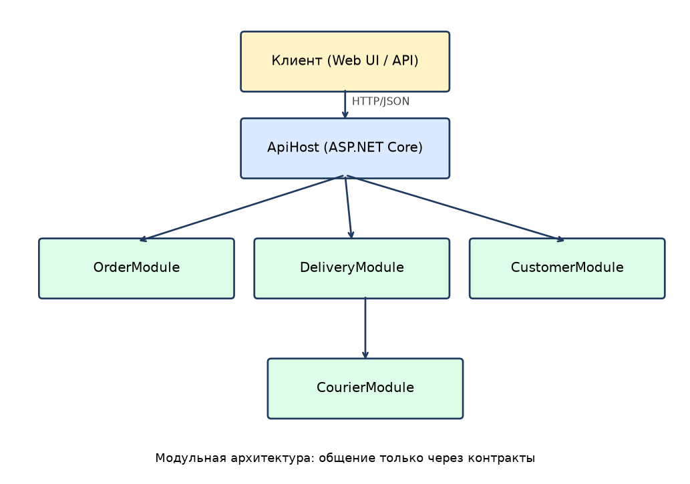
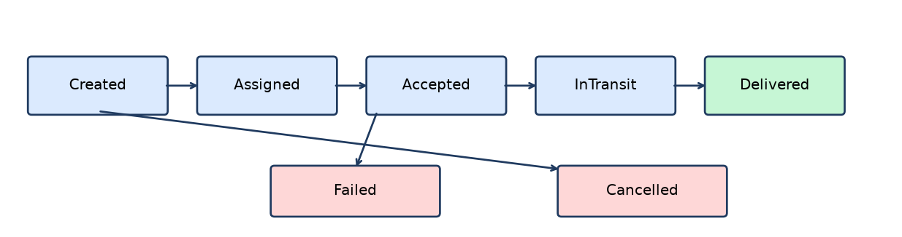
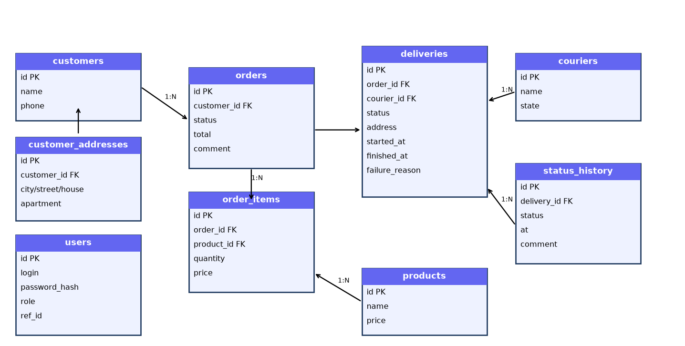
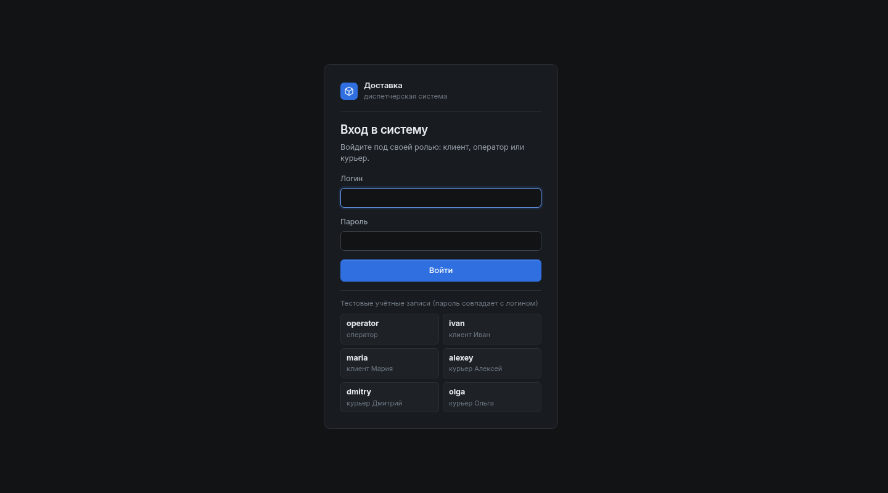
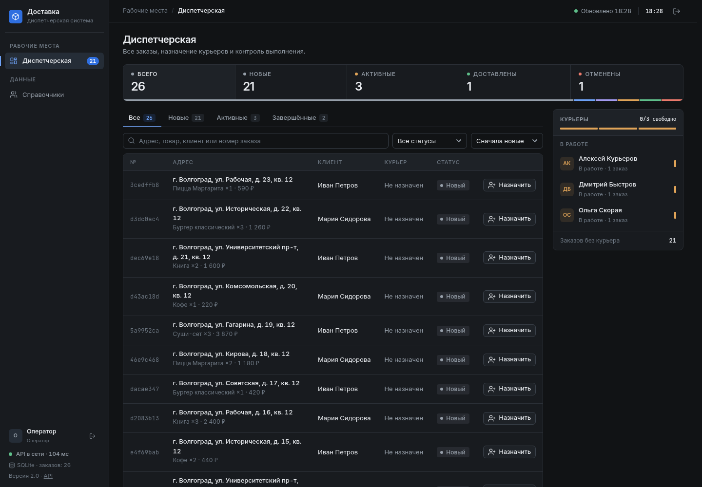
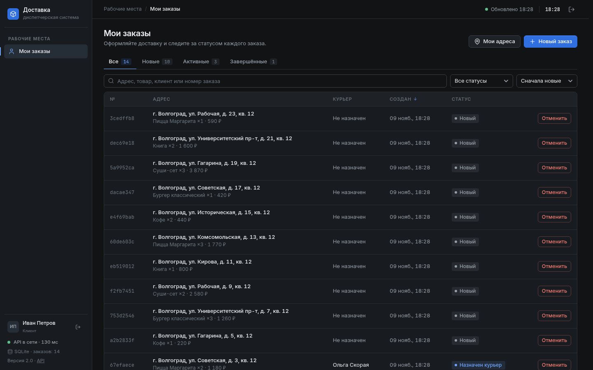
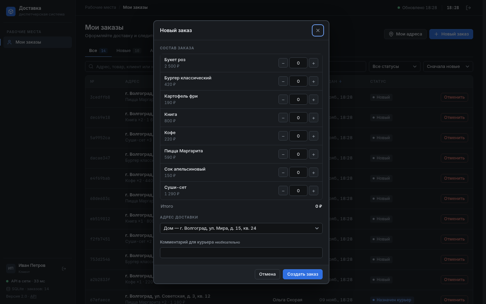
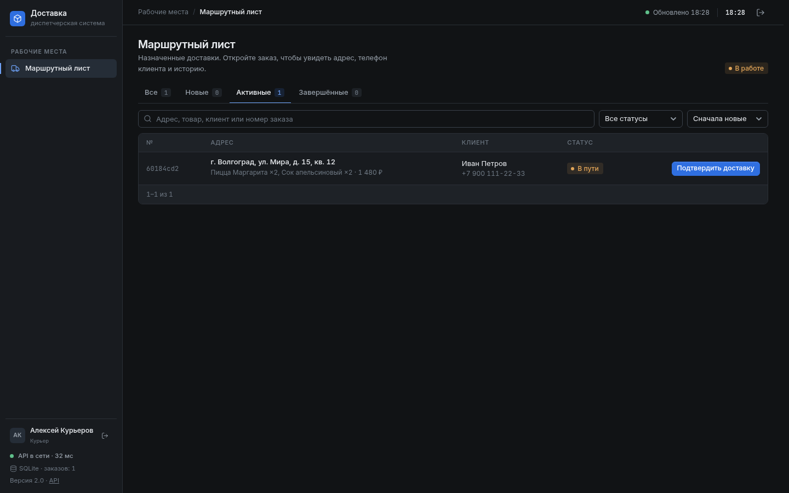
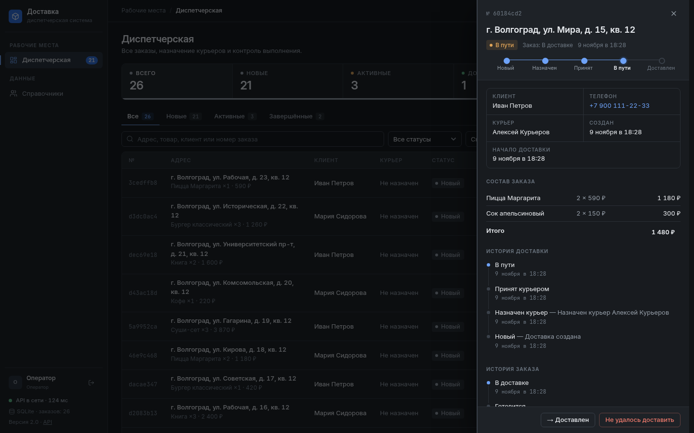
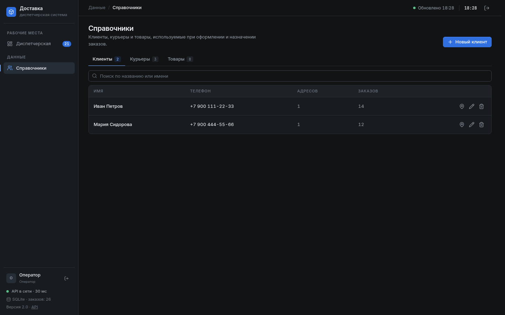

# Order Delivery Management System

Система управления доставкой заказов: клиент создаёт заказ, оператор назначает курьера, курьер двигает доставку по статусам. Всё с историей изменений.



## Что умеет
Вход по логину и паролю, три роли:

| Роль | Логин / пароль (демо) | Что может |
|---|---|---|
| Клиент | `ivan` / `ivan`, `maria` / `maria` | создаёт заказ из товаров (количество, итог), выбирает или сохраняет адрес, редактирует и отменяет заказ до передачи курьеру, подтверждает получение |
| Оператор | `operator` / `operator` | видит все заказы, назначает курьера (вручную или автоматически), меняет статусы, ведёт справочники. Заказы **не создаёт** |
| Курьер | `alexey`, `dmitry`, `olga` (пароль = логин) | свой маршрутный лист, статусы «принял / в пути / доставил / не удалось» (с причиной), переключатель онлайн/офлайн |

- Заказ и доставка имеют **раздельные статусы**. Доставка: `Created → Assigned → Accepted → InTransit → Delivered`, а также `Failed` (обязательна причина) и `Cancelled`. Заказ: `Created, Confirmed, Preparing, InDelivery, Delivered, Cancelled` — выводится из статуса доставки.
- Состояния курьера: `Available, Busy, Offline, Blocked`. Занятого, офлайн и заблокированного назначить нельзя; после финального статуса курьер освобождается.
- `POST /api/orders` создаёт заказ + доставку и сразу подбирает свободного курьера. Если свободных нет — доставка остаётся `Created`, оператор назначит позже.
- Фиксируются время начала и завершения доставки, история статусов доставки и заказа.
- Недопустимые переходы, повторное создание доставки и т. п. API отклоняет единым форматом ошибки `{success:false, errorCode, error, message}`.

Статусы доставки:



## Как устроено
- `src/ApiHost` — ASP.NET Core 9 minimal API, SQLite-хранилище (`Store.cs`), авторизация (`Auth.cs`), статический UI (`wwwroot/index.html`, без фреймворков).
- `src/Contracts` — DTO и перечисления; `OrderModule`, `DeliveryModule`, `CourierModule`, `CustomerModule` — бизнес-правила каждого модуля (`*Rules.cs`), общение через контракты.
- `tests/` — 46 тестов (правила модулей и сценарии на реальной SQLite).
- `docs/` — этапы курсового, ADR, архитектура, тесты.


## База данных
SQLite, один файл (`data/delivery.db` локально, `/data/delivery.db` в Docker). Схема и демо-данные создаются сами при первом старте. Версия схемы хранится в `PRAGMA user_version` (сейчас 2); если найден файл старой версии, он пересоздаётся. В Docker файл лежит в volume `delivery-data`.



- `customers`, `customer_addresses` — клиенты и их сохранённые адреса.
- `couriers` — курьеры с состоянием; `users` — учётные записи (пароли PBKDF2) и роль.
- `products`, `orders`, `order_items` — товары, заказы и их позиции (цена фиксируется в позиции).
- `deliveries` — доставка: курьер, адрес, статус, `started_at`, `finished_at`, причина неудачи.
- `status_history`, `order_history` — история статусов доставки и заказа.

Строка подключения — `ConnectionStrings:Default`. Сбросить данные — удалить файл БД (или `docker compose down -v`).

## Запуск
**Через Docker** (нужен только Docker):
```bash
docker compose up --build
```
**Без Docker** (нужен [.NET 9 SDK](https://dotnet.microsoft.com/download/dotnet/9.0)): `run.bat` (Windows) или `./run.sh` (Linux/Mac), либо
```bash
dotnet run --project src/ApiHost --no-launch-profile --urls http://localhost:8080
```
Открыть: **http://localhost:8080**. Проверка живости: `GET /api/health`.

Тесты: `dotnet test OrderDeliveryManagementSystem.sln`.

## Интерфейс
Тёмная диспетчерская консоль: компактные таблицы, акцентный синий, шрифты Inter и JetBrains Mono лежат локально (`wwwroot/fonts`, лицензии OFL рядом). На телефоне интерфейс перестраивается в мобильное приложение.















## API
Все endpoints, кроме `health` и `login`, требуют `Authorization: Bearer <token>` и проверяют роль.

| Метод | Endpoint | Что делает |
|---|---|---|
| POST | `/api/auth/login`, `/api/auth/logout` | вход / выход |
| GET | `/api/auth/me`, `/api/state` | текущий пользователь; данные для UI (фильтруются по роли) |
| GET | `/api/health` | проверка живости |
| POST | `/api/orders` | создать заказ (+ доставка, автоназначение) |
| GET / PUT | `/api/orders/{id}` | получить / изменить заказ (пока Created/Assigned) |
| POST | `/api/deliveries` | создать доставку для заказа (повтор → 409 `DELIVERY_ALREADY_EXISTS`) |
| GET | `/api/deliveries?q=&status=&courierId=&customerId=` | поиск и фильтр |
| GET | `/api/deliveries/{id}` | доставка с историей |
| POST | `/api/deliveries/{id}/assign` | назначить курьера (пустой `courierId` — авто) |
| PATCH | `/api/deliveries/{id}/status` | сменить статус (`Failed` требует `reason`) |
| POST | `/api/deliveries/{id}/confirm` | клиент подтверждает получение |
| GET/POST/PUT/DELETE | `/api/customers`, `/api/couriers`, `/api/products` | справочники |
| GET/POST | `/api/customers/{id}/addresses` | адреса клиента |
| GET/PUT/DELETE | `/api/addresses/{id}` | адрес |
| GET | `/api/couriers/available` | свободные курьеры |
| GET | `/api/couriers/{id}/deliveries` | доставки курьера |
| PATCH | `/api/couriers/{id}/state` | состояние курьера |

Подробнее — в [docs/contracts.md](docs/contracts.md); соответствие ТЗ — в [docs/tz-traceability.md](docs/tz-traceability.md).

## Ограничения
Сессии хранятся в памяти (после перезапуска сервера нужен повторный вход), демо-пароли равны логинам — для боевого использования их нужно сменить.

## Не входит
Платежи, GPS, карты, SMS, мобильное приложение, маркетплейсы.
