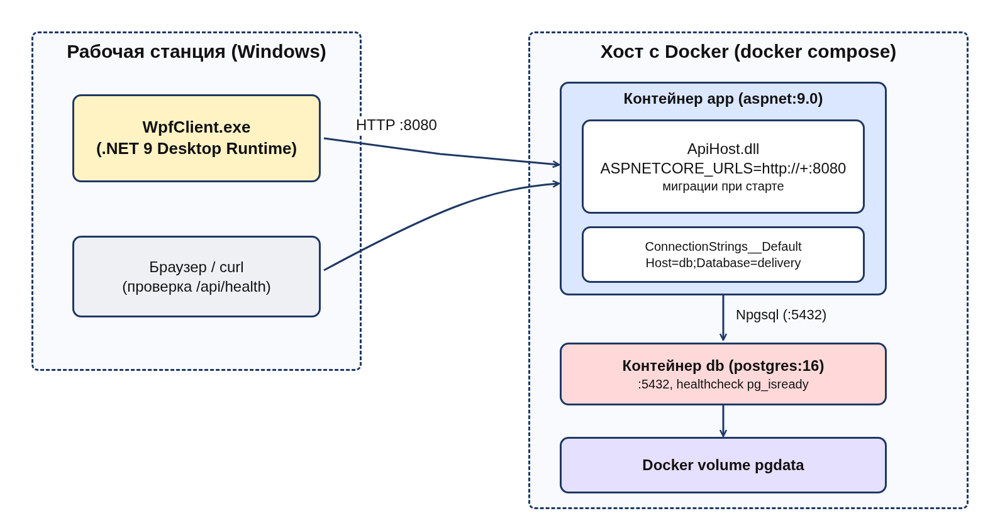
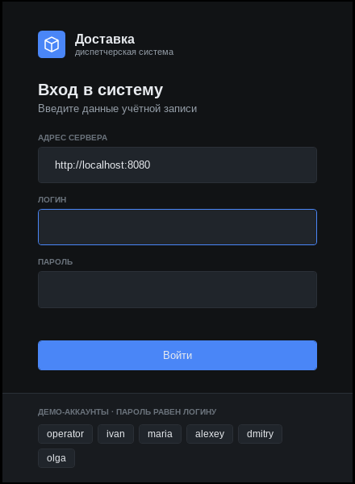
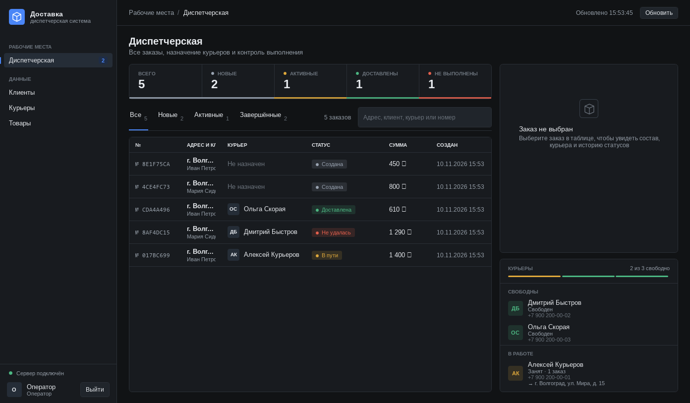
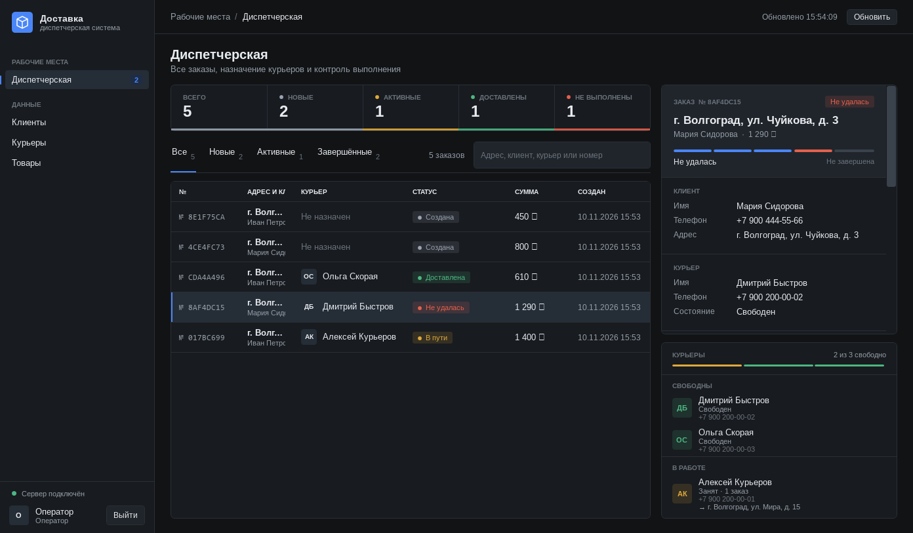
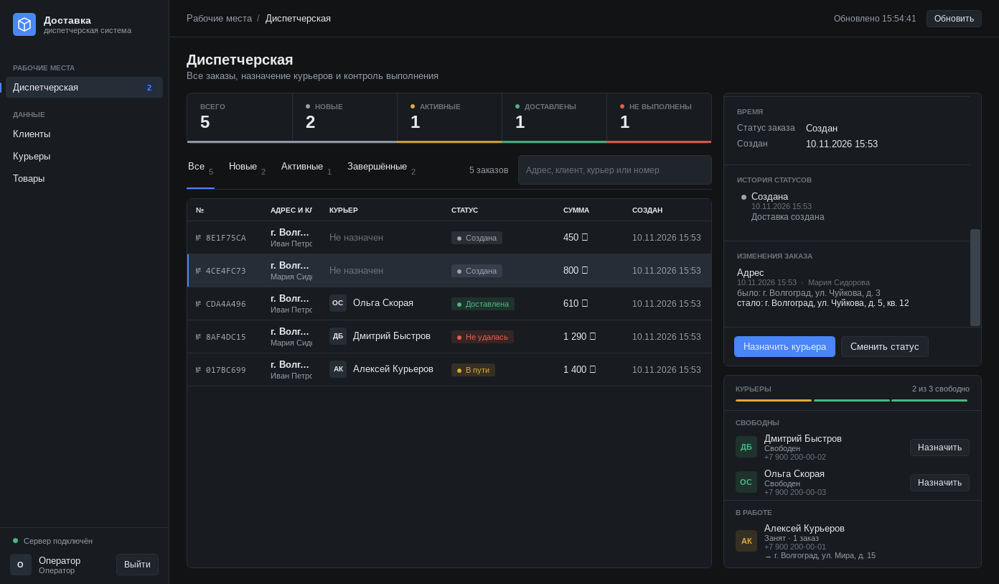

# Order Delivery Management System

Клиент-серверная система управления доставкой заказов: сервер на ASP.NET Core 9 и PostgreSQL, клиентское приложение на WPF. Клиент оформляет заказ, оператор назначает курьера и контролирует выполнение, курьер ведёт доставку по статусам. Все изменения сохраняются в истории.

## Содержание
- [Возможности](#что-умеет)
- [Архитектура](#как-устроено)
- [База данных](#база-данных)
- [Зависимости](#зависимости)
- [Запуск](#запуск)
- [Интерфейс](#интерфейс)
- [API](#api)

## Что умеет
Вход по логину и паролю, три роли. Клиент может **зарегистрироваться сам** — кнопкой «Создать учётную запись клиента» в окне входа или запросом `POST /api/auth/register` (см. [«Регистрация»](#регистрация)); курьеров и других клиентов заводит оператор.

Демо-учётные записи ниже создаются только при локальной разработке (`ASPNETCORE_ENVIRONMENT=Development`); в рабочем окружении их нет (см. [«Рабочее развёртывание»](#рабочее-развёртывание)).

| Роль | Логин / пароль (демо) | Что может |
|---|---|---|
| Клиент | `ivan` / `ivan`, `maria` / `maria` или своя учётная запись после регистрации | создаёт заказ из товаров (количество, итог), выбирает или сохраняет адрес, редактирует и отменяет заказ до передачи курьеру, подтверждает получение |
| Оператор | `operator` / `operator` | видит все заказы, назначает курьера (вручную или автоматически), меняет статусы, ведёт справочники. Заказы **не создаёт** |
| Курьер | `alexey`, `dmitry`, `olga` (пароль = логин) | свой маршрутный лист, статусы «принял / в пути / доставил / не удалось» (с причиной), переключатель онлайн/офлайн |

- Заказ и доставка имеют **раздельные статусы**. Доставка: `Created → Assigned → Accepted → InTransit → Delivered`, а также `Failed` (обязательна причина) и `Cancelled`. Неудачную доставку оператор может повторить (`retry`): она возвращается в `Created`, предыдущая попытка остаётся в истории. Заказ: `Created, Confirmed, Preparing, InDelivery, Delivered, Cancelled, DeliveryFailed` — выводится из статуса доставки: `Failed → DeliveryFailed` (доставка не удалась), `Cancelled → Cancelled` (заказ отменён). Подробнее — [ADR-006](docs/decisions/ADR-006-order-and-delivery-statuses.md).
- Состояния курьера: `Available, Busy, Offline, Blocked`. Занятого, офлайн и заблокированного назначить нельзя; после финального статуса курьер освобождается.
- `POST /api/orders` создаёт заказ + доставку и сразу подбирает свободного курьера с наименьшим числом доставок за последние 24 часа (при равенстве — по имени). Если свободных нет или назначение сорвалось из-за сбоя БД — доставка остаётся `Created`, и **фоновая служба назначит курьера автоматически**, как только он освободится или база восстановится (оператор по-прежнему может назначить вручную). У курьера не бывает двух активных доставок одновременно — это гарантирует и уникальный индекс в БД.
- Фиксируются время начала и завершения доставки, история статусов доставки и заказа (с автором действия) и журнал изменений заказа: состав, адрес, комментарий (было → стало, кто и когда).
- Создание заказа атомарно; сбой автоназначения не отменяет заказ. Необязательный `requestId` в `POST /api/orders` делает повтор запроса идемпотентным: тот же ключ с теми же данными возвращает уже созданный заказ, тот же ключ с другими товарами, количеством, адресом или комментарием — `409 IDEMPOTENCY_CONFLICT`. Ключ действует в рамках клиента.
- Деньги хранятся в копейках, наружу отдаются в рублях (`decimal`).
- Недопустимые переходы, повторное создание доставки и т. п. API отклоняет единым форматом ошибки `{success:false, errorCode, error, message}`.

Статусы доставки:


## Как устроено
- `src/ApiHost` — ASP.NET Core 9 minimal API, хранилище на PostgreSQL (`Store.cs`), миграции схемы (`Db/`), авторизация (`Auth.cs`), проверка конфигурации при запуске (`StartupChecks.cs`), фоновое назначение курьеров (`AssignmentRetryService.cs`).
- `src/Contracts` — DTO и перечисления; `OrderModule`, `DeliveryModule`, `CourierModule`, `CustomerModule` — бизнес-правила каждого модуля (`*Rules.cs`), общение через контракты.
- `src/WpfClient` — клиентское приложение WPF (вход, регистрация клиента, рабочие места по ролям).
- `tests/` — 258 тестов (правила модулей, сценарии, миграции, идемпотентность, фоновое назначение, регистрация, конфигурация, HTTP-API и роли на реальном PostgreSQL).
- `docs/` — этапы курсового, ADR, архитектура, тесты.


## База данных
PostgreSQL 16. Строка подключения — `ConnectionStrings:Default`: для локальной разработки она задана в `src/ApiHost/appsettings.Development.json` (`Host=localhost;Port=5432;Database=delivery;Username=delivery;Password=delivery`), в рабочем окружении — только через переменную `ConnectionStrings__Default` или другое внешнее хранилище; в общем `appsettings.json` пароля нет. Схема создаётся и обновляется **версионированными миграциями** при старте (`src/ApiHost/Db/Migrations.cs`, учёт — таблица `schema_migrations`). Каждая миграция выполняется в транзакции; таблицы и данные автоматически не удаляются. Если схема неизвестна, создана более новой версией или миграция упала, приложение не стартует и пишет причину. На пустой базе в Development добавляются демо-данные, в рабочем окружении — только оператор (см. «Рабочее развёртывание»). В Docker данные лежат в volume `pgdata`.


Текстовое описание схемы — в [docs/architecture.md](docs/architecture.md#схема-бд-миграции-00010006) (диаграмма показывает таблицы миграций 0001–0004; 0005 добавляет `orders.request_hash`, 0006 — индексы очереди назначения и активных доставок курьера). Основные таблицы: `customers`, `customer_addresses`, `couriers`, `users` (пароли PBKDF2), `products` (`price_kopecks`), `orders`, `order_items`, `deliveries`, `status_history`, `order_history`, `order_changes`, `sessions`, `schema_migrations`.

### Обновление версии
Новая версия приложения при старте сама применяет недостающие миграции; уже применённые не повторяются, данные сохраняются. Перед обновлением рабочей базы сделайте резервную копию:
```bash
docker compose exec db pg_dump -U delivery -d delivery > backup.sql
```
Подробнее — [docs/architecture.md](docs/architecture.md#обновление-установки).

## Зависимости
- **.NET 9 SDK / ASP.NET Core 9** — сервер и API (minimal API).
- **PostgreSQL 16 + Npgsql** — хранение данных.
- **xUnit** (+ Test.Sdk, coverlet) — тесты.
- **WPF (.NET 9, Windows)** — клиентское приложение; сторонних пакетов не использует.
- **Docker** — по желанию, для запуска без .NET.

Связи между модулями и полная таблица — в [docs/dependencies.md](docs/dependencies.md).

## Запуск

Конфигурация разделена по окружениям (`ASPNETCORE_ENVIRONMENT`):

| | Development (локально, учебный запуск) | Production (сервер) |
|---|---|---|
| Настройки | `appsettings.json` + `appsettings.Development.json` | `appsettings.json` + переменные окружения |
| Строка подключения | `delivery/delivery` на `localhost` | обязательна, пароль ≥ 12 символов, не стандартный |
| Демо-пользователи | создаются (`Seed:Demo=true`) | запрещены: при `Seed:Demo=true` сервер не стартует |
| PostgreSQL в Docker | порт только на `127.0.0.1` | порт наружу не публикуется |
| Запуск | `./run.sh`, `run.bat`, Visual Studio, `docker compose up` | `docker compose -f docker-compose.prod.yml up -d` |

При запуске вне Development сервер проверяет конфигурацию и отказывается стартовать, перечисляя все проблемы: не задана строка подключения, пароль PostgreSQL пустой/короткий/стандартный (`delivery`, `postgres`, …), включены демо-данные, слабый `Seed:OperatorPassword`.

### Локальная разработка
Требуется [.NET 9 SDK](https://dotnet.microsoft.com/download/dotnet/9.0) и PostgreSQL (проще всего `docker compose up -d db`).
```bash
./run.sh            # Linux, macOS
run.bat             # Windows
# или вручную
ASPNETCORE_ENVIRONMENT=Development dotnet run --project src/ApiHost --no-launch-profile --urls http://localhost:8080
```
В Visual Studio: Multiple startup projects — `ApiHost` (профиль `http`, Development) и `WpfClient`. Без `ASPNETCORE_ENVIRONMENT=Development` приложение запускается как рабочее и потребует настоящих паролей.

Приложение доступно на http://localhost:8080, проверка работоспособности — `GET /api/health`.

### Docker (локально)
```bash
docker compose up --build
```
Поднимает PostgreSQL (`db`) и API (`app`) на http://localhost:8080 с демо-данными. Оба порта открыты только на `127.0.0.1`, поэтому с других машин база и API недоступны. Переменные: `POSTGRES_PASSWORD` (по умолчанию `delivery`), `DB_PORT` (по умолчанию 5432), `APP_BIND=0.0.0.0` — если WPF-клиент запущен на другой машине.

### Рабочее развёртывание
1. Скопируйте шаблон и задайте свои значения (файл `.env` в Git не добавляется):
   ```bash
   cp .env.example .env
   # POSTGRES_PASSWORD — уникальный, не короче 12 символов
   # OPERATOR_PASSWORD — пароль учётной записи operator, не короче 8 символов
   ```
2. Запустите:
   ```bash
   docker compose -f docker-compose.prod.yml up -d --build
   ```
   Без `POSTGRES_PASSWORD` compose не запустится. PostgreSQL работает во внутренней сети `backend` и наружу не публикуется; API слушает `APP_PORT` (по умолчанию 8080) — для доступа из интернета поставьте перед ним обратный прокси с HTTPS.
3. На пустой базе создаётся только пользователь `operator` с паролем `OPERATOR_PASSWORD` — без клиентов, курьеров, товаров и демо-паролей. После первого входа смените пароль (`POST /api/auth/password`); переменную `OPERATOR_PASSWORD` после этого можно убрать.
4. Оператор заводит курьеров и товары. Клиенты регистрируются сами; если это не нужно, задайте `ALLOW_REGISTRATION=false` — тогда клиентов создаёт только оператор.

Переменные `.env`: `POSTGRES_DB`, `POSTGRES_USER`, `POSTGRES_PASSWORD`, `OPERATOR_PASSWORD`, `APP_PORT`, `ASSIGNMENT_RETRY_INTERVAL`, `ASSIGNMENT_MAX_BACKOFF`, `ALLOW_REGISTRATION`, `MAX_REGISTRATIONS_PER_HOUR` (описаны в `.env.example`).

Без Docker: задайте переменные окружения `ASPNETCORE_ENVIRONMENT=Production`, `ConnectionStrings__Default`, `Seed__OperatorPassword` (первый запуск) и запустите `dotnet ApiHost.dll`. Секреты храните в переменных окружения, Docker secrets или другом хранилище секретов, а не в `appsettings*.json`; `appsettings.Local.json`, `appsettings.Production.json`, `.env` исключены из Git.

Контейнер API работает от непривилегированного пользователя `app`.

### Фоновое назначение курьеров
Секция `Assignment` (переменные `Assignment__*`):

| Параметр | По умолчанию | Назначение |
|---|---|---|
| `Enabled` | `true` | включить фоновое назначение (ручное работает всегда) |
| `RetryIntervalSeconds` | `15` | интервал опроса доставок `Created` без курьера |
| `MaxBackoffSeconds` | `300` | максимальная пауза при недоступной БД (пауза удваивается после каждой неудачи) |
| `BatchSize` | `20` | сколько доставок назначается за один проход |

Служба безопасно работает в нескольких экземплярах API (`FOR UPDATE SKIP LOCKED`), не создаёт дублей и пишет в лог каждую успешную и неудачную попытку. Подробнее — [ADR-008](docs/decisions/ADR-008-deployment-idempotency-assignment-recovery.md).

### Регистрация
Клиент создаёт учётную запись сам: в WPF — кнопка «Создать учётную запись клиента» в окне входа (имя, телефон, логин, пароль с повтором), через API — `POST /api/auth/register`:
```json
{ "name": "Анна Новикова", "phone": "+7 900 123-45-67", "login": "anna.n", "password": "Strong-pass-42" }
```
Ответ такой же, как у входа (`token`, `role: "client"`, `refId`, `name`), — клиент сразу может оформлять заказы.

- Логин: 3–32 символа — латинские буквы, цифры, точка, дефис, подчёркивание; регистр не учитывается (`Ivan` и `ivan` — один логин). Занятый логин — `409 LOGIN_TAKEN`, неверный формат — `400 INVALID_LOGIN`.
- Пароль: не короче 8 символов, не равен логину и не из списка простых (`400 WEAK_PASSWORD`).
- Так регистрируются только клиенты; курьеров и операторов создаёт оператор.
- Настройки секции `Security`: `AllowRegistration` (по умолчанию `true`; при `false` — `403 REGISTRATION_DISABLED`) и `MaxRegistrationsPerHour` (по умолчанию 20 попыток в час с одного адреса, сверх лимита — `429 TOO_MANY_REGISTRATIONS`).

### Безопасность учётных записей
- Пароли хранятся как PBKDF2-SHA256 (100 000 итераций), токены сессий — как SHA-256.
- После 5 неудачных попыток входа под одним логином вход блокируется на 5 минут (`429 TOO_MANY_ATTEMPTS`; `Security:MaxLoginFailures`, `Security:LoginLockoutSeconds`).
- Пароль новой учётной записи — не короче 8 символов и не равен логину; если оператор его не задал, генерируется случайный из 12 символов (при самостоятельной регистрации пароль обязателен).
- Сессия живёт 12 часов; при смене пароля остальные сессии пользователя завершаются. Если сессия закончилась, WPF-клиент сообщает об этом и возвращает к окну входа.
- При удалении клиента или курьера его сессии сразу становятся недействительными.

Схема развёртывания:



### WPF-клиент
Сначала запустите сервер, затем (Windows):
```bash
dotnet run --project src/WpfClient
```
или `run-client.bat`. В окне входа адрес сервера по умолчанию `http://localhost:8080`; если сервер запущен в Docker, он тот же.

### Тесты
Нужен PostgreSQL с правом `CREATE DATABASE` (например, `docker run -d -p 127.0.0.1:5432:5432 -e POSTGRES_PASSWORD=postgres postgres:16`); адрес — переменная `TEST_PG_ADMIN` (по умолчанию `postgres:postgres@localhost:5432`). Каждый тест работает в собственной временной базе.
```bash
dotnet restore OrderDeliveryManagementSystem.sln
dotnet build OrderDeliveryManagementSystem.sln
dotnet test OrderDeliveryManagementSystem.sln
```

## Интерфейс
Клиентское приложение — WPF (`src/WpfClient`, .NET 9, Windows), тёмная тема. Общается с сервером по REST API с Bearer-токеном. Окно входа принимает адрес сервера, логин и пароль; там же можно зарегистрироваться как клиент. Кнопки демо-аккаунтов работают только с сервером в режиме Development. Дальше интерфейс зависит от роли:

- **Оператор**: диспетчерская (все заказы, поиск, назначение курьера вручную или автоматически, смена статуса, подтверждение получения) и справочники клиентов, курьеров и товаров.
- **Клиент**: «Мои заказы», создание заказа из товаров с количеством, выбор или сохранение адреса, изменение и отмена заказа до принятия курьером, подтверждение получения.
- **Курьер**: маршрутный лист, кнопки «Принять», «В пути», «Доставлено», «Не удалось» (с причиной), переход на линию и обратно.

Скриншоты настоящего WPF-клиента (запущен с API на PostgreSQL):





Неудачная доставка отображается как «Не удалась» (`DeliveryFailed`), а не как отмена заказа:



Журнал изменений заказа (было → стало, кто и когда):



Список обновляется автоматически каждые 8 секунд, справа показана карточка заказа с составом, статусом заказа, временем, историей статусов и журналом изменений.

## API
Все endpoints, кроме `health`, `login` и `register`, требуют `Authorization: Bearer <token>` и проверяют роль.

| Метод | Endpoint | Что делает |
|---|---|---|
| POST | `/api/auth/login`, `/api/auth/logout` | вход / выход (сессии хранятся в PostgreSQL и переживают перезапуск, 12 часов); после 5 неудачных попыток — `429 TOO_MANY_ATTEMPTS` |
| POST | `/api/auth/register` | регистрация клиента (`name`, `phone`, `login`, `password`), сразу возвращает токен; `409 LOGIN_TAKEN`, `400 INVALID_LOGIN` / `WEAK_PASSWORD`, `403 REGISTRATION_DISABLED`, `429 TOO_MANY_REGISTRATIONS` |
| POST | `/api/auth/password` | смена своего пароля (`oldPassword`, `newPassword` ≥ 8 символов); остальные сессии пользователя завершаются |
| GET | `/api/auth/me`, `/api/state` | текущий пользователь; данные для UI (фильтруются по роли) |
| GET | `/api/health` | проверка живости |
| POST | `/api/orders` | создать заказ (+ доставка, автоназначение); необязательный `requestId` — идемпотентность, повтор с другими данными — `409 IDEMPOTENCY_CONFLICT` |
| GET / PUT | `/api/orders/{id}` | получить / изменить заказ (пока Created/Assigned); не переданный `comment` не меняется |
| GET | `/api/orders/{id}/changes` | журнал изменений заказа |
| POST | `/api/deliveries` | создать доставку для заказа (повтор → 409 `DELIVERY_ALREADY_EXISTS`) |
| GET | `/api/deliveries?q=&status=&courierId=&customerId=` | поиск и фильтр |
| GET | `/api/deliveries/{id}` | доставка с историей |
| POST | `/api/deliveries/{id}/assign` | назначить курьера (пустой `courierId` — авто) |
| PATCH | `/api/deliveries/{id}/status` | сменить статус (`status`, `comment`; для `Failed` причина в `comment` обязательна) |
| POST | `/api/deliveries/{id}/confirm` | подтверждение получения (клиент — своего заказа, оператор) |
| POST | `/api/deliveries/{id}/retry` | оператор: повторить неудачную доставку (`Failed` → `Created`, курьер подбирается заново, история сохраняется) |
| GET/POST/PUT/DELETE | `/api/customers`, `/api/couriers`, `/api/products` | справочники |
| GET/POST | `/api/customers/{id}/addresses` | адреса клиента |
| GET/PUT/DELETE | `/api/addresses/{id}` | адрес |
| GET | `/api/couriers/available` | свободные курьеры |
| GET | `/api/couriers/{id}/deliveries` | доставки курьера |
| PATCH | `/api/couriers/{id}/state` | состояние курьера |

Подробнее — в [docs/contracts.md](docs/contracts.md); соответствие ТЗ — в [docs/tz-traceability.md](docs/tz-traceability.md).

Ошибки сервера (`STORAGE_ERROR`, `INTERNAL_ERROR`) и некорректный JSON (`INVALID_REQUEST`) тоже приходят в едином формате ошибок. Если база данных временно недоступна, `STORAGE_ERROR` возвращается с кодом 503 и заголовком `Retry-After` — запрос можно повторить (создание заказа — с тем же `requestId`).

## Версии и история изменений
Версия — `Directory.Build.props` (сейчас 2.2.0, семантическое версионирование), список изменений — [CHANGELOG.md](CHANGELOG.md). Сообщения коммитов — [Conventional Commits](https://www.conventionalcommits.org/ru/v1.0.0/) (`feat`, `fix`, `refactor`, `test`, `docs`, `build`, `chore`).
