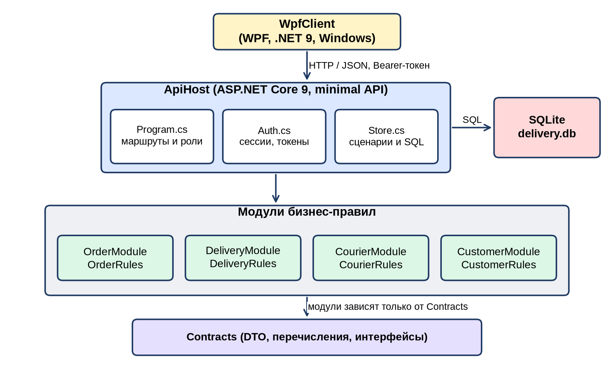
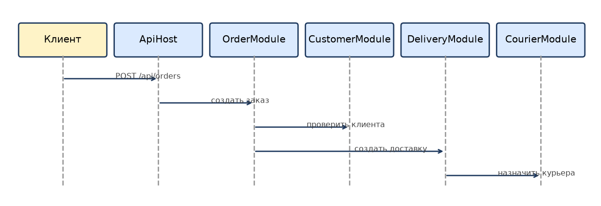
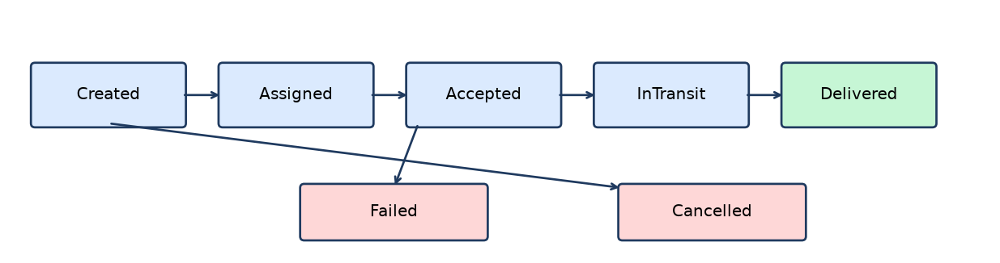
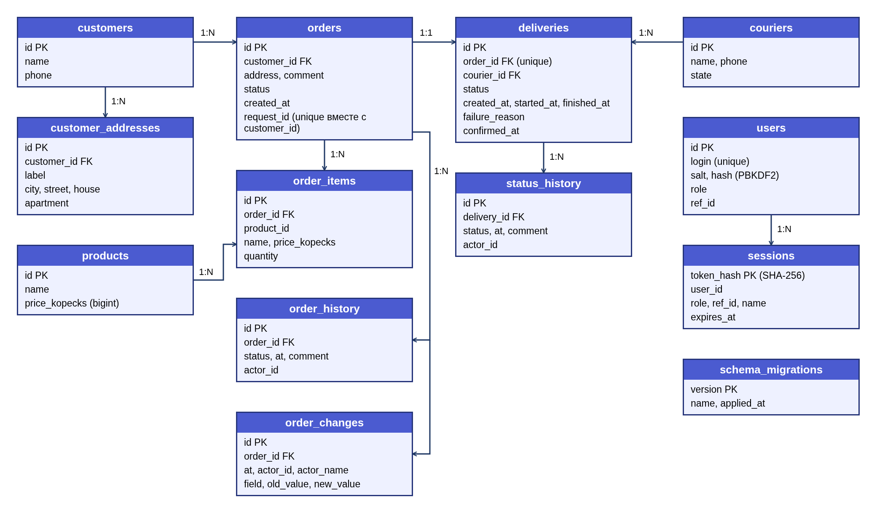

# Архитектура

Используется модульная архитектура с отдельным API-слоем.



## Основной сценарий



## Принцип зависимостей

Внешний API зависит от контрактов модулей. Модули не должны обращаться к внутренним классам друг друга напрямую. Обмен выполняется через интерфейсы и DTO.

Диаграмма статусов доставки:



Реализация: каждый модуль (`OrderModule`, `DeliveryModule`, `CourierModule`, `CustomerModule`) содержит свои бизнес-правила (`*Rules.cs`), а `ApiHost` отвечает за HTTP, авторизацию по ролям и хранение в PostgreSQL (`Store.cs`, транзакции на создание заказа и смену статуса). Это упрощение под курсовой: отдельных процессов и баз у модулей нет.


---

## Актуальное состояние реализации (v2.0.0)

Первоначальный текст выше сохранён как основа. Фактическая реализация отличается следующим (решения — в [ADR-004…007](decisions/)):

- **Хранилище — PostgreSQL**, а не SQLite. Схема создаётся и обновляется версионированными миграциями (`src/ApiHost/Db`), данные при обновлении не удаляются.
- **Бизнес-логика** выполняется в `ApiHost.Store`, который применяет статические правила модулей (`OrderRules`, `DeliveryRules`, `CourierRules`, `CustomerRules`, `Money`). Отдельных сервисов `OrderService`/`DeliveryService` нет (удалены как неиспользуемые). Межмодульные «протоколы» из [contracts.md](contracts.md) реализованы как операции `Store` и HTTP API.
- **Консистентность:** операции выполняются транзакциями, строки блокируются `SELECT ... FOR UPDATE`, поэтому API можно запускать в нескольких экземплярах.
- **Деньги** — целые копейки (`bigint`), наружу рубли (`decimal`).
- **Статусы:** заказ выводится из доставки; `Failed → DeliveryFailed`, `Cancelled → Cancelled`.

### Схема БД (миграции 0001–0004)

```text
customers(id, name, phone)                      customer_addresses(id, customer_id, label, city, street, house, apartment)
couriers(id, name, phone, state)                products(id, name, price_kopecks)
users(id, login, salt, hash, role, ref_id)      orders(id, customer_id, address, comment, status, created_at, request_id)
order_items(id, order_id, product_id, name, price_kopecks, quantity)
deliveries(id, order_id, courier_id, status, created_at, started_at, finished_at, failure_reason, confirmed_at)
status_history(id, delivery_id, status, at, comment, actor_id)   order_history(id, order_id, status, at, comment, actor_id)
order_changes(id, order_id, at, actor_id, actor_name, field, old_value, new_value)
sessions(token_hash, user_id, role, ref_id, name, expires_at)
schema_migrations(version, name, applied_at)
```

Диаграмма схемы (PostgreSQL, миграции 0001–0004):



### Обновление существующей установки

1. Сделайте резервную копию файла SQLite (`data/delivery.db`; он должен быть схемы v2 — запустите прежнюю версию приложения один раз, если нет).
2. Поднимите PostgreSQL (`docker compose up -d db`) и один раз запустите приложение, чтобы создались таблицы, либо дайте пустую базу — импортёр сам применит миграции. **Целевая база должна быть пустой**: если API уже запускался, он добавил демо-данные — используйте новую пустую БД.
3. `dotnet run --project tools/SqliteImport -- data/delivery.db "Host=localhost;Port=5432;Database=delivery;Username=delivery;Password=delivery"`.
   Перенос идёт одной транзакцией, исходный файл не меняется. Цены переводятся в копейки, заказы с неудачной доставкой получают статус `DeliveryFailed`, пароли сохраняются.
4. Запустите приложение с `ConnectionStrings__Default`, указывающей на эту БД.
